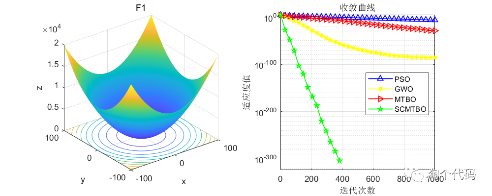
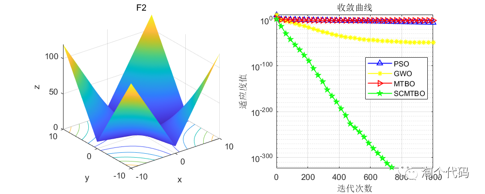
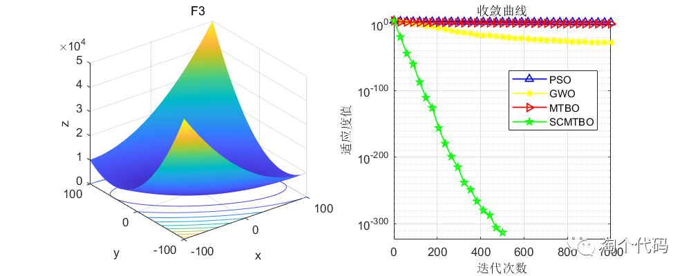
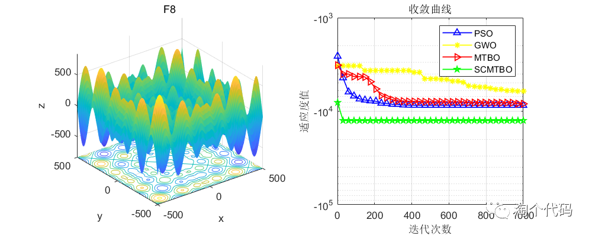
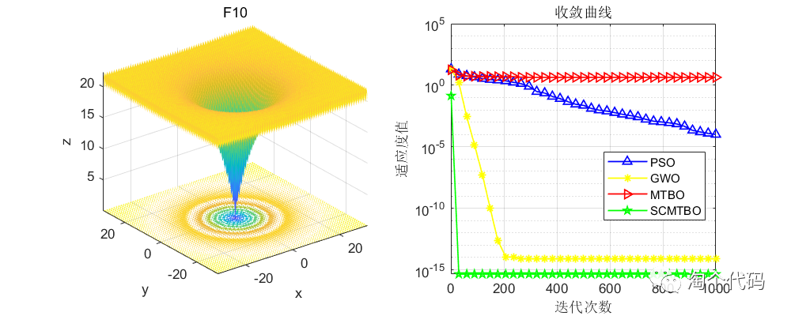

# 2023 Intelligent Algorithm Improvement - Mountaineering Team Optimization Algorithm with Fusion of Cosine and Cauchy Variations

Today's main subject is: Mountaineering Team-Based Optimization (MTBO) Algorithm.
This algorithm was proposed by Faridmehr in March 2023. This article improves it using the cosine and Cauchy mutation. The principle of improvement is the same as the previous article. The sparrow search algorithm, which integrates cosine and Cauchy mutation, is compared with the Grey Wolf Algorithm and Particle Swarm Optimization.
On the basis of the Mountaineering Team-Based Optimization Algorithm, the improvements are as follows:
1. Initiate mountaineers with a refraction reverse learning strategy, essentially by calculating the reverse solution of the current solution to expand the search range and thereby find better candidate solutions for the given problem;
2. Replace the original Mountaineering Team Algorithm's assist climbing position update formula with the cosine strategy. Although the assist climbing formula considers the influence of the team leader and new members, it is too random, leading the algorithm to easily fall into local solutions;
3. Improve the step size search factor of the cosine strategy; the original step size search factor shows a linear declining trend, which is not conducive to further balancing the global search and local development capabilities of the Mountaineering Team Optimization Algorithm.
4. Replace the random replacement member phase of the original Mountaineering Team Optimization Algorithm with the Cauchy mutation strategy. In the random replacement member phase, new members are generated using normal distribution random numbers. The Cauchy distribution is similar to the standard normal distribution, being a continuous probability distribution with values near zero at the origin, relatively long at both ends, approaching zero slowly, hence generating greater perturbation than the normal distribution. Therefore, using the Cauchy mutation to perturb individuals in the position update of mountaineers, thus expanding the search scale of the Mountaineering Team Optimization Algorithm, and thereby enhancing the ability of the algorithm to escape from local optima.
The principles, formulas, and ideas of the above four points are referenced in the following documents:
References: [1] Li Ailian, Quan Lingxiang, Cui Guimei, et al. Integrating Cosine and Cauchy Mutation for Sparrow Search Algorithm[J]. Computer Engineering and Application, 2022, 58(3): 91-99.
References on the Mountaineering Team Optimization Algorithm:
References:
Faridmehr, I.; Nehdi, M.L.; Davoudkhani, I.F.; Poolad, A. Mountaineering Team-Based Optimization: A Novel Human-Based Metaheuristic Algorithm. Mathematics 2023, 11, 1273. https://doi.org/10.3390/math11051273  
Tested on the CEC2005 function set, the results are as follows: SCMTBO is the improved algorithm proposed in this paper, MTBO is the original mountaineering team optimization algorithm, GWO is the gray wolf optimization algorithm, and PSO is the particle swarm optimization algorithm.  
The number of particles for each algorithm was set to 100 after 1000 iterations.  
Results analysis: In the tests with single peak and multi-peak functions, it can be seen that the mountaineering team optimization algorithm, which integrates refraction principles, cosine strategy, and Cauchy mutation, has shown very good results after improvement! As mentioned in the previous article, we can use Cauchy mutation and cosine strategy for the improvement of other algorithms. Everyone can combine the code from the previous article and compare them, gradually learning, and then improve their own algorithms.  
Code display:
\nclear all \nclose all\nclc\n\nN=100; % Number of search agents\n\nFunction_name='F1'; % Name of the test function, range from F1-F23\niter=1000; % Maximum number of iteration times\n\n% Load details of the selected benchmark function\n[lb,ub,dim,fobj]=CEC2005(Function_name);\n\n%% MTBO\n[fMin , bestX,MTBO_Convergence_curve ] =MTBO(N,iter,lb,ub,dim,fobj);\ndisplay(['The best optimal value of the objective funciton found by MTBO  for ' [num2str(Function_name)],'  is : ', num2str(fMin)]);\nfprintf ('Best solution obtained by MTBO: %s\n', num2str(bestX,'%e  '));\n\n%% PSO\n[Best_score,Best_pos,PSO_curve]=PSO(N,iter,lb,ub,dim,fobj);  % Calculating the solution of the given problem using PSO\ndisplay(['The best optimal value of the objective funciton found by PSO  for ', [num2str(Function_name)],'  is : ', num2str(Best_score)]);\nfprintf ('Best solution obtained by PSO: %s\n', num2str(Best_pos,'%e  '));\n%% gwo\n[Alpha_score,Alpha_pos,GWO_Convergence_curve]=GWO(N,iter,lb,ub,dim,fobj);  % Calculating the solution of the given problem using gwo\ndisplay(['The best optimal value of the objective funciton found by GWO  for ', [num2str(Function_name)],'  is : ', num2str(Alpha_score)]);\nfprintf ('Best solution obtained by GWO: %s\n', num2str(Alpha_pos,'%e  '));\n\n%% MTBO\n[SCMTBO_fMin,SCMTBO_bestX,SCMTBO_curve]=SCMTBO(N,iter,lb,ub,dim,fobj);\ndisplay(['The best optimal value of the objective funciton found by SCMTBO  for ' [num2str(Function_name)],'  is : ', num2str(SCMTBO_fMin)]);\nfprintf ('Best solution obtained by SCMTBO: %s\n', num2str(SCMTBO_bestX,'%e  '));\n%Draw objective space\n %% Figure\nfigure1 = figure('Color',[1 1 1]);\nG1=subplot(1,2,1,'Parent',figure1);\nfunc_plot(Function_name)\ntitle(Function_name)\nxlabel('x')\nylabel('y')\nzlabel('z')\nsubplot(1,2,2)\nG2=subplot(1,2,2,'Parent',figure1);\nCNT=35;\nk=round(linspace(1,iter,CNT)); % Randomly select CNT points\n% Note: If the number of points drawn on the convergence curve is small, and the random points are sparse, it indicates that the number of points has been insufficient. At this time, the number of points should be increased gradually, such as 100, 200, 300, etc.\n% Conversely, if the random points on the convergence curve are very dense, it indicates that too many points have been taken. In this case, the number of points should be reduced.\niter=1:1:iter;\nsemilogy(iter(k),PSO_curve(k),'b-^','linewidth',1);\nhold on\nsemilogy(iter(k),GWO_Convergence_curve(k),'y-*','linewidth',1);\nhold on\nsemilogy(iter(k),MTBO_Convergence_curve(k),'r->','linewidth',1);\nhold on\nsemilogy(iter(k),SCMTBO_curve(k),'g-p','linewidth',1);\ngrid on;\ntitle('Convergence curve')\nxlabel('Iteration count');\nylabel('Fitness value');\nbox on\nlegend('PSO','GWO','MTBO','SCMTBO')\nset (gcf,'position', [300,300,800,320])\nMountaine climbing team optimization algorithm code (if you have downloaded the code before, just copy the below code into your own folder).)  
function [Destination_fitness,Destination_position,Convergence_curve]=MTBO(N,Max_iteration,lb,ub,dim,fobj)\n\n% disp('MTBO: Mountaineering Team Based Optimization')\n\nCostFunction = @(x) fobj(x);\n\nnVar = dim;          % Number of Variables\nVarSize = [1 nVar]; \nVarMin = lb;       %Variables Lower Bound\nVarMax =ub ;       %Variables Upper Bound\n\n%% MTBO Parameters\n\nMaxIt = Max_iteration;        % Maximum Number of Iterations\n\nnPop = N;           % Population Size\n\n%% Initialization \n\n% Empty Structure for Individuals\nempty_individual.Position = [];\nempty_individual.Cost = [];\n\n% Initialize Population Array\npop = repmat(empty_individual, nPop, 1);\n\n% Initialize Best Solution\nBestSol.Cost = inf;\n\n% Initialize Population Members\nfor i=1:nPop\n    pop(i).Position = unifrnd(VarMin, VarMax, VarSize);\n    pop(i).Cost = CostFunction(pop(i).Position);\n    \n    if pop(i).Cost < BestSol.Cost\n        BestSol = pop(i);\n    end\nend\n\n% Initialize Best Cost Record\nBestCosts = zeros(MaxIt,1);\n\n%% MTBO Main Loop\n\nfor it=1:MaxIt\n    \n    % Calculate Population Mean\n    Mean = 0;\n    for i=1:nPop\n        Mean = Mean + pop(i).Position;\n    end\n    Mean = Mean/nPop;\n    \n    % Select Leader\n    Leader = pop(1);\n \n    for i=2:nPop\n        if pop(i).Cost < Leader.Cost\n            Leader = pop(i);\n               end\n    end\n    \n     \n    for i=1:nPop\n        % Create Empty Solution\n        newsol = empty_individual;\n      \n     \n        ii=i+1;\n        if ii>nPop\n            ii=1;\n        end\n       Li=(0.25+0.25*rand);\n        Ai=(0.75+0.25*rand);\n        Mi=(0.75+0.25*rand);\n        if rand<Li\n        newsol.Position = pop(i).Position ...\n            +rand(VarSize).*(pop(ii).Position-pop(i).Position) + rand(VarSize).*(Leader.Position-pop(ii).Position);\n        elseif rand<Ai\n              newsol.Position = pop(i).Position ...\n            + 1*rand(VarSize).*(pop(i).Position-pop(nPop).Position); \n         elseif rand<Mi\n              newsol.Position = pop(i).Position ...\n            + 1*rand(VarSize).*(Mean-pop(i).Position); \n        else\n\n            newsol.Position = unifrnd(VarMin, VarMax, VarSize); \n\n        \n    end\n        \n   \n        newsol.Position = max(newsol.Position, VarMin);\n        newsol.Position = min(newsol.Position, VarMax);\n\n        newsol.Cost = CostFunction(newsol.Position);\n   \n        if newsol.Cost<pop(i).Cost\n            pop(i) = newsol;\n             if pop(i).Cost < Leader.Cost\n            Leader = pop(i);\n                      end\n        end\n    end\n% Sort Population\n    [uuu, SortOrder]=sort([pop.Cost]);\n    pop = pop(SortOrder);\n   \n    % Store Record for Current Iteration\n Convergence_curve(it) =pop(1).Cost;\n     \nend\n\n%% Results\nDestination_fitness=pop(1).Cost;\nDestination_position=pop(1).Position;\nend\n\nImproved mountaineering team optimization algorithm code, author placed in the backend zip file.。  

## Images

<!-- PAYMENT_BLOCK -->

## Get this dataset

- Payment link (Stripe): [Buy now](https://buy.stripe.com/3cs8yP7sY87d0vu9AB)
- Payment QR code: 

<!-- /PAYMENT_BLOCK -->
